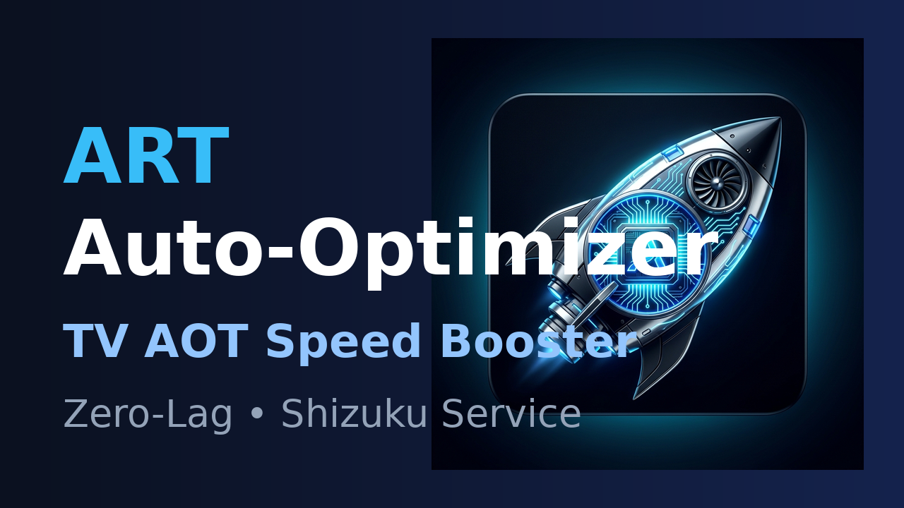
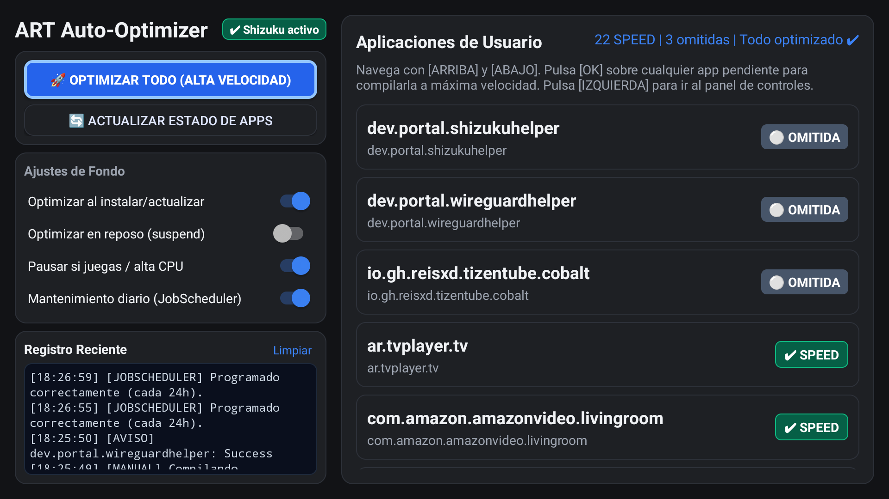

# ART Auto-Optimizer for Android TV

<p align="center">
  
</p>

<p align="center">
  
  
  
  
  
</p>

---

## 🚀 ¿Qué es ART Auto-Optimizer?

**ART Auto-Optimizer** es una herramienta ultraligera (< 300 KB) diseñada específicamente para **Android TV y Google TV** que acelera el rendimiento de todas las aplicaciones instaladas forzando la compilación nativa **AOT (Ahead-Of-Time)** al modo de máxima velocidad (`speed`) mediante el compilador interno de Android (`dex2oat`).

En televisores y reproductores multimedia, la mayoría de aplicaciones descargadas de Google Play o instaladas por APK se ejecutan en modo **interpretado** o con compilación parcial (`speed-profile`), provocando arranques lentos, tirones en las interfaces y retrasos al cambiar de canal o menú. **ART Auto-Optimizer** compila el 100% del código a instrucciones de máquina nativas para eliminar por completo el lag.

---

## 📸 Captura de Pantalla

<p align="center">
  
</p>

---

## ✨ Características Principales

* ⚡ **Compilación Completa en Modo `speed`:** Compila todos los métodos y clases dex a código máquina nativo.
* 🚀 **Modo Manual Prioritario:** Compilación a máxima potencia de CPU para optimizar una o todas las aplicaciones en pocos segundos.
* 🌙 **Modo Segundo Plano Sin Tirones (`nice -n 19`):** Durante el mantenimiento de fondo, el proceso se ejecuta con la menor prioridad de planificación del kernel para que nunca interrumpa la reproducción de streaming ni la fluidez del televisor.
* 🕒 **Mantenimiento Diario con `JobScheduler`:** Integración oficial con el planificador nativo de Android (Job ID 2026) para mantener las aplicaciones siempre optimizadas cada 24 horas.
* 🛡️ **Monitor de Seguridad y Térmico:** Pausa automáticamente la optimización si la CPU está saturada, el dispositivo tiene temperatura elevada o se está ejecutando un juego pesado.
* 💤 **Control de Reposo / Suspend:** Permite elegir si el mantenimiento diario puede actuar mientras el televisor está en espera con la pantalla apagada o si debe esperar a que esté encendido.
* 🎮 **Interfaz 100% Adaptada a Mando TV:** Navegación por cruceta (D-pad), indicadores de foco luminosos, selector dinámico y visor de registro reciente con desplazamiento suave.
* 🔄 **Actualización en Tiempo Real:** Las insignias de estado y contadores se actualizan dinámicamente según finaliza cada compilación.
* ⚪ **Detección Inteligente de Incompatibles:** Si una app no admite compilación (debuggable, stub o fija por el sistema), se marca automáticamente como `⚪ OMITIDA` para no reintentar en bucle.
* 🪶 **Consumo Cero:** No mantiene servicios residentes pesados; consume 0% de CPU y batería en reposo.

---

## ❓ Preguntas Frecuentes y Compatibilidad

### ¿Sirve para cualquier Android TV?
**Sí.** Es compatible con cualquier dispositivo con Android TV o Google TV:
* Smart TVs: Sony Bravia, Philips, TCL, Xiaomi TV, Hisense, etc.
* Reproductores / Dongles: Chromecast con Google TV, Xiaomi Mi Box / TV Stick, Fire TV Stick (FireOS 7+), televisores Orange/Movistar/Vodafone, cajas AOSP, etc.

### ¿Desde qué versión de Android hasta cuál funciona?
* **Mínimo:** Android 6.0 Marshmallow (API 23).
* **Óptimo:** Android 7.0 Nougat (API 24) hasta Android 14 / 15+ (API 34/35).
* Es compatible con todas las versiones modernas de ART (Android Runtime).

### ¿Funciona en arquitecturas de 64 bits (`arm64-v8a`) y 32 bits (`armeabi-v7a`)?
**Sí, en ambas.** La aplicación es 100% agnóstica de arquitectura porque está escrita en bytecode puro dex. Cuando se solicita al sistema que compile una aplicación a modo `speed`, el motor ART del dispositivo ejecuta automáticamente el compilador correspondiente de su arquitectura nativa:
* Dispositivos de 64 bits (`arm64-v8a`): compila usando `/apex/com.android.art/bin/dex2oat64`.
* Dispositivos de 32 bits (`armeabi-v7a`): compila usando `/apex/com.android.art/bin/dex2oat32`.
* Emuladores x86 / x86_64.

### ¿Por qué requiere Shizuku?
La instrucción de compilación del sistema (`cmd package compile`) y la lectura del estado Dexopt requieren permisos de usuario de sistema (`UID 2000 shell` o `UID 0 root`).
Por motivos de seguridad de SELinux, las aplicaciones normales de usuario no tienen permitido modificar la compilación de otras apps sin privilegios elevados.
**Shizuku** otorga estos privilegios de forma limpia, oficial y segura a través de un Binder IPC, sin necesidad de rootear el televisor (solo requiere activar depuración por red una única vez).

### ¿Qué significan las insignias de estado?
* **`✔ SPEED` (verde):** Optimización nativa completa (AOT). Rendimiento máximo y arranques inmediatos.
* **`⚠ PARCIAL` (amarillo):** Perfil básico de Google Play (`speed-profile`). Solo una parte de los métodos está compilada; el resto corre interpretado.
* **`⚠ SIN OPTIMIZAR` (amarillo):** La aplicación corre directamente interpretada o verificada sin compilar.
* **`⚪ OMITIDA` (gris):** Paquetes que no admiten compilación (modo debug o componentes fijos del fabricante).

---

## 🛠️ Compilación desde Código Fuente

El proyecto no requiere pesados entornos como Gradle o Android Studio. Incluye un script autónomo [`build.sh`](build.sh) que descarga las herramientas oficiales de Android (SDK 33, D8, Shizuku) y compila en segundos:

```bash
git clone https://github.com/knives69/art-auto-optimizer.git
cd art-auto-optimizer
chmod +x build.sh
./build.sh
```

El APK firmado y optimizado se genera en `./art-auto-optimizer-shizuku.apk`.

### Instalación rápida por ADB:
```bash
adb connect <IP_DE_TU_TV>:5555
adb install -r art-auto-optimizer-shizuku.apk
```

---

## 📄 Licencia

Este proyecto está bajo la licencia [MIT](LICENSE).
